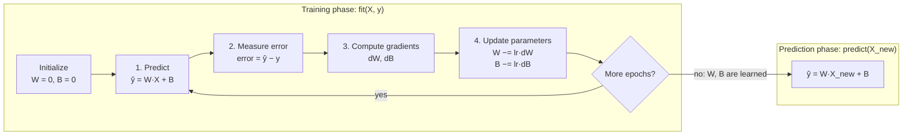

# Simple Model from Scratch: Linear Regression

A short, readable implementation of linear regression with **plain NumPy**. There's no scikit-learn and no deep-learning framework, so you can see exactly how a model **learns its weights** during training and how it **uses them** to make predictions.

If you've ever wondered what actually happens inside `model.fit()`, this repo is for you.

---

## Quick start

```bash
git clone https://github.com/sravanipamu/simple-model-from-scratch.git
cd simple-model-from-scratch
pip install -r requirements.txt
python linear-regression.py
```

Output:

```
Predictions: [13.42249671 41.55592537 25.92624278 60.31154447]
Learned weights: [3.12593652]
Learned bias: 4.044687154420624
```

---

## The big picture

Every supervised ML model has two phases:

| Phase | Question it answers | Method in this code |
|---|---|---|
| **Training** | "What values of W and B make my predictions closest to the real answers?" | `fit(X, y)` |
| **Prediction** | "Given a new input, what output do my learned W and B give?" | `predict(X)` |

The model itself is a straight line:

```
y = W · x + B
```

- **W (weight):** the slope, or how much `y` changes when `x` goes up by 1
- **B (bias):** the intercept, or the value of `y` when `x` is 0

The model starts out knowing nothing (`W = 0`, `B = 0`) and improves them a little at a time.



---

## 1. The data

```python
np.random.seed(0)
X = 2 * np.random.rand(100, 1)                    # 100 random x values in [0, 2)
y = 3 * X.flatten() + 4 + np.random.randn(100)    # true rule: y = 3x + 4, plus noise
```

We create the data ourselves so we **know the right answer**: W should come out close to **3** and B close to **4**. The random noise makes it realistic, because real data never sits exactly on a line.

The first three samples:

| x | y (actual) |
|---|---|
| 1.0976 | 6.1277 |
| 1.4304 | 9.1920 |
| 1.2055 | 8.0822 |

---

## 2. Training phase: how the weights are learned

`fit()` runs the same four steps over and over. One full pass over all 100 samples is called an **epoch**, and we run 1000 of them.

### Step 0: Initialize

```python
self.weights = np.zeros(n_features)   # W = 0
self.bias = 0                         # B = 0
```

The model starts with no knowledge, so every prediction is 0.

### Step 1: Predict

```python
y_predicted = np.dot(X, self.weights) + self.bias
```

Use the current W and B to guess `y` for all 100 samples at once.

### Step 2: Measure how wrong we are (loss)

```python
loss = np.mean((y_predicted - y) ** 2)
```

This is the **Mean Squared Error (MSE)**:

```
loss = (1/n) · Σ (ŷᵢ − yᵢ)²
```

- `ŷ − y` is the error for each sample
- Squaring makes every error positive and punishes big mistakes more
- The mean gives one number: the lower it is, the better the line fits

> In the code, `loss` is computed after the update, but it uses `y_predicted` from Step 1, so it measures the error of the W and B *before* this epoch's update. Training itself doesn't need the loss. It's computed so you can watch it shrink, for example by adding `print(loss)` inside the loop.

### Step 3: Compute gradients (which way to move)

```python
dw = (1 / n_samples) * np.dot(X.T, (y_predicted - y))
db = (1 / n_samples) * np.sum(y_predicted - y)
```

A **gradient** answers: *"If I increase W (or B) a tiny bit, does the loss go up or down, and by how much?"*

These formulas are the derivatives of the MSE loss:

```
dW = (2/n) · Σ (ŷᵢ − yᵢ) · xᵢ      (the code drops the constant 2; it just gets absorbed into the learning rate)
dB = (2/n) · Σ (ŷᵢ − yᵢ)
```

How to read them:

- **dW < 0** means the loss goes *down* if W goes *up*, so W should increase
- **dW > 0** means the loss goes *up* if W goes *up*, so W should decrease
- The bigger |dW| is, the further W is from where it should be

### Step 4: Update the parameters (gradient descent)

```python
self.weights -= self.learning_rate * dw
self.bias    -= self.learning_rate * db
```

```
W_new = W_old − learning_rate × dW
B_new = B_old − learning_rate × dB
```

We step in the **opposite** direction of the gradient, which is downhill on the loss. That's why it's called **gradient descent**.

The **learning rate** (`0.01`) sets the step size:

- Too small: learning is very slow
- Too large: the steps overshoot and the loss can blow up instead of shrinking
- About right: steady progress toward the minimum

Picture standing on a foggy hill. You can't see the bottom, but you can feel which way the ground slopes under your feet. You take a small step downhill and repeat. The loss is the height, and the gradient is the slope under your feet.

---

## 3. A worked example: the first epoch

Start: `W = 0`, `B = 0`

| Step | Calculation | Result |
|---|---|---|
| Predict | ŷ = 0·x + 0 | every prediction is **0** |
| Error | ŷ − y | all errors are large and negative (we predict too low) |
| Loss | mean(error²) | **53.33** |
| Gradient dW | (1/100) · Σ errorᵢ · xᵢ | **−7.6336** (negative, so W should go up) |
| Gradient dB | (1/100) · Σ errorᵢ | **−7.0291** (negative, so B should go up) |
| Update W | 0 − 0.01 × (−7.6336) | **W = 0.0763** |
| Update B | 0 − 0.01 × (−7.0291) | **B = 0.0703** |

After a single epoch, both parameters have moved toward the right answer.

---

## 4. Watching the model learn

The values below come from this script. The loss is computed with the W and B at the start of each epoch, and W and B are shown after the epoch's update.

| Epoch | Loss (MSE) | W | B |
|---|---|---|---|
| 1 | 53.3303 | 0.0763 | 0.0703 |
| 2 | 51.1990 | 0.1511 | 0.1392 |
| 3 | 49.1547 | 0.2242 | 0.2066 |
| 10 | 37.0027 | 0.6951 | 0.6422 |
| 100 | 1.9933 | 3.1737 | 3.0524 |
| 500 | 1.0379 | 3.3207 | 3.8250 |
| 1000 | 1.0015 | **3.1259** | **4.0447** |

What to notice:

1. **The loss drops fast at first, then slowly.** Early on the gradients are big because the line is far off, so the steps are big. Near the minimum the gradients shrink toward 0, so the steps shrink too.
2. **W overshoots and then comes back.** W climbs past 3 (to about 3.32 around epoch 500), then works its way back down as B catches up. W and B trade off against each other because changing the slope and changing the intercept can both move the line toward the data.
3. **The model never reaches exactly W = 3, B = 4.** The noise means 3 and 4 aren't the best fit for *this* sample. The best possible fit is W ≈ 2.97, B ≈ 4.22 (loss ≈ 0.992). After 1000 epochs gradient descent is close (loss ≈ 1.0015) but still moving slowly. More epochs or a larger learning rate would get it closer.
4. **A loss near 1.0 is the floor.** The noise we added has a variance of 1, so no straight line can do much better.

---

## 5. Prediction phase: using what was learned

```python
def predict(self, X):
    return np.dot(X, self.weights) + self.bias
```

Once training is done, **W and B are fixed**. Prediction doesn't involve any learning, gradients or loss. It's just the line equation applied to new inputs:

```python
predictions = model.predict([[3], [12], [7], [18]])
```

| x (new input) | Calculation | Prediction |
|---|---|---|
| 3 | 3.1259 × 3 + 4.0447 | **13.42** |
| 12 | 3.1259 × 12 + 4.0447 | **41.56** |
| 7 | 3.1259 × 7 + 4.0447 | **25.93** |
| 18 | 3.1259 × 18 + 4.0447 | **60.31** |

> The model was trained on x values between 0 and 2, but here it predicts for x = 3 to 18. That's **extrapolation**. It works here only because the true relationship really is a straight line. With real-world data, predictions far outside the training range are much less reliable.

---

## 6. Training vs. prediction at a glance

| | Training (`fit`) | Prediction (`predict`) |
|---|---|---|
| Input | X **and** the correct answers y | X only |
| W and B | change every epoch | fixed |
| Computes loss? | yes | no |
| Computes gradients? | yes | no |
| Repeats? | 1000 epochs | one pass |
| Cost | expensive (done once) | cheap (done many times) |

Every ML model follows this design, from this one-line model up to a large neural network. The model is bigger and the gradients are computed automatically (backpropagation), but the loop is the same: **predict, measure the error, compute gradients, update the weights, repeat.**

---

## Try it yourself

Edit `linear-regression.py` and see what happens:

- **Print the loss:** add `if _ % 100 == 0: print(_, loss)` inside the training loop
- **Change the learning rate:** try `0.001` (too slow: W ≈ 3.16, B ≈ 3.04 after 1000 epochs), `0.5` (reaches the best fit W ≈ 2.97, B ≈ 4.22), and `1.0` (too big: the values blow up to around 10²⁸)
- **Change the number of epochs:** try `100` vs `10000`. How close do W and B get to 3 and 4?
- **Change the true rule:** generate `y = -2 * X + 10 + noise` and check that the model finds it
- **Add more noise:** multiply `np.random.randn(100)` by 3. What happens to the final loss?

---

## Glossary

| Term | Meaning |
|---|---|
| **Weight (W)** | How strongly the input affects the output (the slope) |
| **Bias (B)** | The baseline output when the input is 0 (the intercept) |
| **Epoch** | One full pass over all the training data |
| **Loss / cost** | One number measuring how wrong the predictions are |
| **MSE** | Mean Squared Error, the average of the squared errors |
| **Gradient** | The direction and steepness of the loss with respect to a parameter |
| **Learning rate** | How big a step to take on each update |
| **Gradient descent** | Repeatedly stepping parameters opposite to the gradient to reduce the loss |

## Requirements

- Python 3.8+
- NumPy
